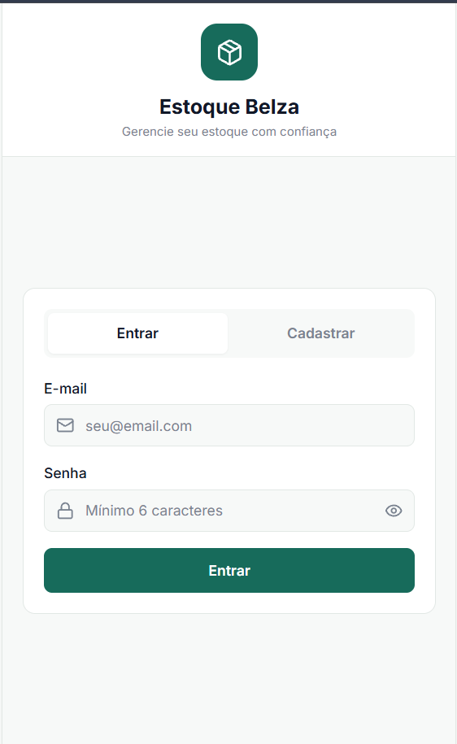
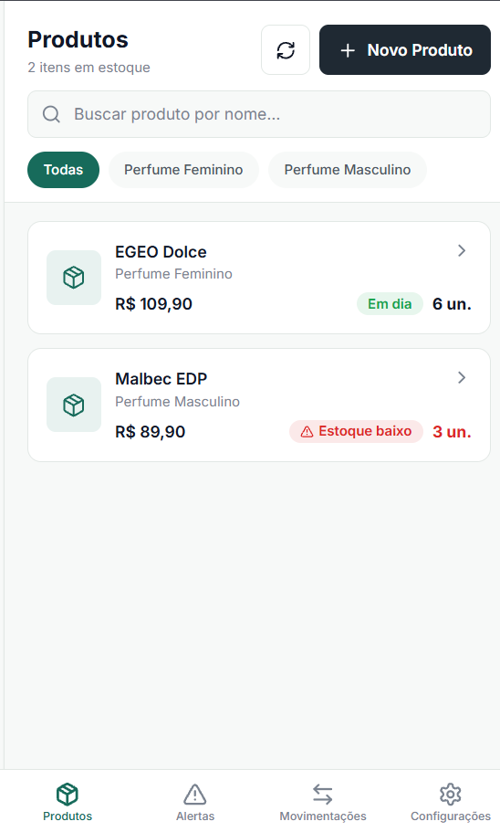
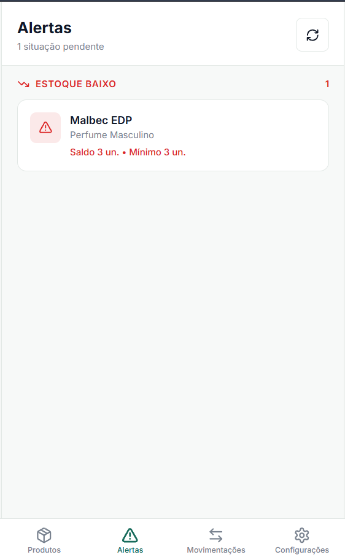
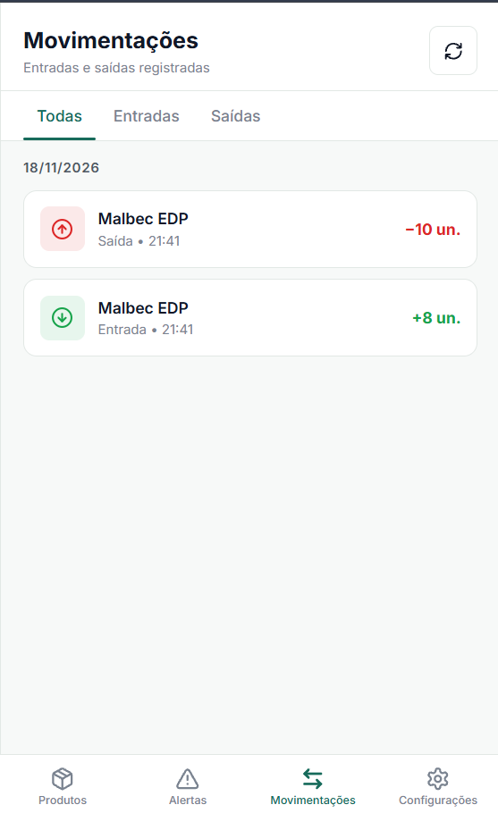
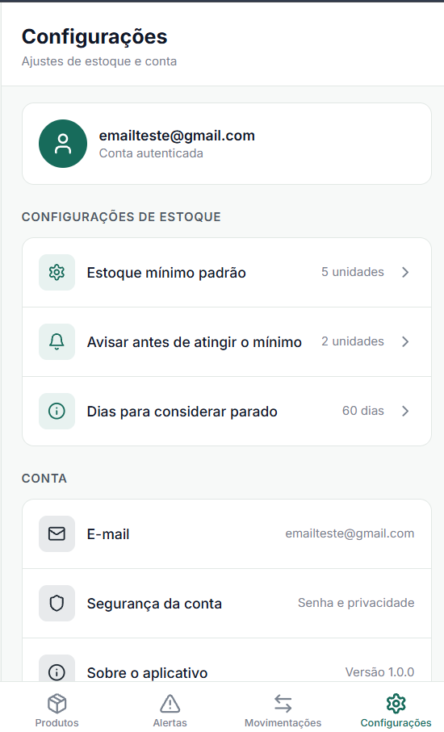
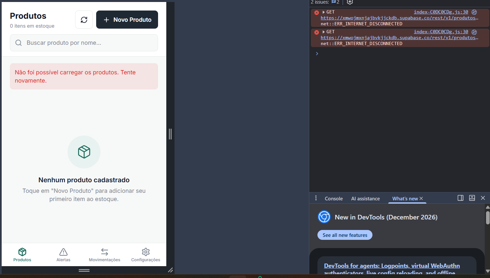
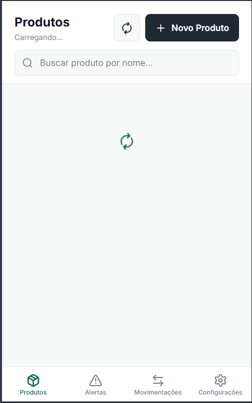
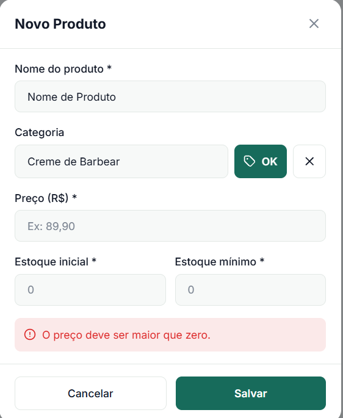

# Especificação do MVP — Sistema web de gerenciamento de estoque

## Tela Login:


## Tela Produtos:


## Tela Alertas:


## Tela Movimentações


## Tela Configurações


# Tela Offline:


## Tela Carregamento:


## Tela Erro:


## ✦ 01 · CONTEXT Contexto

Pequenos revendedores brasileiros de cosméticos, produtos tecnológicos e roupas frequentemente controlam o estoque com planilhas, cadernos e mensagens, o que dificulta saber a quantidade realmente disponível, registrar movimentações no momento em que acontecem, planejar reposições e perceber produtos sem saída. O MVP será um sistema web responsivo, em português, para permitir o cadastro e a consulta de produtos, o registro de entradas e saídas e a visualização de alertas de estoque baixo e de produtos sem movimentação há mais de 60 dias. A solução deve ser simples para pessoas com familiaridade intermediária com tecnologia e funcionar em celulares e computadores. O escopo inicial prioriza a confiabilidade do saldo e alertas apresentados dentro do próprio sistema; integrações externas, automações comerciais e funcionalidades avançadas ficam para versões futuras.

## ☻ 02 · PERSON Persona

**Camila Rodrigues — revendedora de produtos de beleza**

- **Idade:** 34 anos.
- **Profissão:** Microempreendedora individual (MEI).
- **Cidade:** Campinas — SP.
- **Negócio:** Revenda de cosméticos, maquiagens, perfumes e produtos para cabelo.
- **Familiaridade com tecnologia:** Intermediária; utiliza WhatsApp, Instagram, aplicativos bancários e ferramentas básicas de escritório.
- **Dor principal:** Mantém controles fragmentados em planilhas, caderno e WhatsApp e não confia que o saldo anotado corresponda ao estoque físico. Isso provoca vendas perdidas, compras repetidas, desperdício de produtos esquecidos e tempo gasto conferindo registros.
- **Cenário de uso:** Consulta o sistema pelo celular ou computador durante o atendimento para confirmar a disponibilidade e registrar a saída de um produto. No início da semana, verifica os alertas de estoque baixo e de itens sem movimentação para planejar as compras e decidir o que precisa de atenção.
- **Exemplo:** Um perfume tem estoque mínimo configurado em cinco unidades. Quando o saldo chega a cinco ou menos, Camila espera encontrar um alerta para organizar a reposição antes de perder uma venda.
- **Métrica de sucesso:** Reduzir em 80% as ocorrências em que um produto solicitado por um cliente está indisponível. A comparação deve considerar uma linha de base anterior à adoção e o mesmo tipo de período após a implantação.

## ▤ 03 · RF Requisitos funcionais

| ID | Requisito funcional | Descrição |
|---|---|---|
| RF01 | Cadastrar e editar produtos | O sistema deve permitir cadastrar e atualizar produtos, incluindo ao menos nome, categoria e quantidade inicial. |
| RF02 | Consultar o estoque | O sistema deve exibir os produtos e seus saldos atuais e permitir localizar produtos por nome e categoria. |
| RF03 | Registrar entradas | O sistema deve permitir registrar a entrada de uma quantidade positiva de um produto e somá-la ao saldo atual. |
| RF04 | Registrar saídas | O sistema deve permitir registrar saídas, como vendas, e subtrair a quantidade informada do saldo, impedindo saldo negativo. |
| RF05 | Configurar estoque mínimo | O sistema deve permitir definir e alterar, individualmente por produto, a quantidade mínima desejada. |
| RF06 | Gerar alerta de estoque baixo | O sistema deve gerar um alerta quando o saldo de um produto for menor ou igual à quantidade mínima configurada. |
| RF07 | Identificar produtos sem movimentação | O sistema deve identificar produtos sem entrada ou saída registrada há mais de 60 dias. Para produtos sem movimentação registrada, o prazo deve ser contado a partir do cadastro. |
| RF08 | Listar produtos para reposição | O sistema deve apresentar os produtos com saldo menor ou igual ao mínimo, mostrando ao menos o saldo atual e a quantidade mínima. |
| RF09 | Consultar alertas | O sistema deve disponibilizar uma área que reúna os alertas de estoque baixo e de produtos sem movimentação. |

## 04 · RNF Requisitos não funcionais

| ID | Requisito não funcional | Critério mensurável |
|---|---|---|
| RNF01 | Usabilidade | Em teste com cinco pessoas representativas do público-alvo, pelo menos quatro devem conseguir cadastrar um produto, consultar seu saldo e registrar uma saída sem ajuda de um moderador. |
| RNF02 | Responsividade | As telas principais devem funcionar em larguras de 360 px, 768 px e 1366 px, sem rolagem horizontal da página e sem perda de acesso às ações essenciais. |
| RNF03 | Desempenho | Com uma base de teste de 1.000 produtos e cinco usuários simultâneos, pelo menos 95% das consultas de estoque e operações de movimentação devem responder em até 2 segundos, desconsiderado o tempo de rede fora do controle da aplicação. |
| RNF04 | Segurança e privacidade | As funcionalidades de estoque devem exigir autenticação; senhas não podem ser armazenadas em texto puro; a comunicação em produção deve usar HTTPS; e um usuário não pode consultar ou alterar dados de outra conta. |
| RNF05 | Integridade e consistência | Cada movimentação aceita deve ser persistida integralmente uma única vez e atualizar o saldo de forma atômica. O saldo nunca pode ficar negativo e deve corresponder ao saldo inicial mais entradas menos saídas. |
| RNF06 | Atualização dos alertas | Após uma movimentação confirmada, os alertas de estoque baixo devem refletir o novo saldo em até 1 minuto. A verificação de produtos sem movimentação deve ser executada pelo menos uma vez por dia. |

## ▤ 05 · US Histórias de usuário

As histórias abaixo representam o fluxo central do MVP. Os critérios de aceite associados estão detalhados na seção 06.

### US01 — Manter o cadastro de produtos

Como Camila, quero cadastrar e editar produtos com suas informações básicas e quantidade inicial, para manter meu catálogo de estoque organizado e consultar os itens disponíveis.

**Critérios associados:** AC01, AC02 e AC03.

### US02 — Registrar movimentações do estoque

Como Camila, quero registrar entradas e saídas de produtos, para manter o saldo atualizado conforme as compras e vendas que realizo.

**Critérios associados:** AC04, AC05, AC06 e AC07.

### US03 — Configurar mínimos e acompanhar reposições

Como Camila, quero definir uma quantidade mínima por produto e visualizar os itens que atingiram esse limite, para planejar as compras antes de perder uma venda.

**Critérios associados:** AC08, AC09, AC10 e AC11.

### US04 — Identificar produtos parados e consultar alertas

Como Camila, quero visualizar produtos sem movimentação há mais de 60 dias e consultar os alertas em um só lugar, para decidir quais itens precisam de atenção.

**Critérios associados:** AC12, AC13, AC14 e AC15.

## ✓ 06 · AC Critérios de aceite

Os critérios a seguir são verificáveis por teste funcional. Cada item deve ser marcado após a validação correspondente.

### US01 — Manter o cadastro de produtos

- [ ] **AC01:** Dado que Camila preencha os campos obrigatórios de um produto com valores válidos, quando confirmar o cadastro, então o sistema deve salvar o produto e disponibilizá-lo na consulta de estoque.
- [ ] **AC02:** Dado que Camila tente cadastrar um produto sem informar um campo obrigatório, quando confirmar o cadastro, então o sistema deve impedir a gravação e indicar o campo que precisa ser corrigido.
- [ ] **AC03:** Dado que exista um produto cadastrado, quando Camila alterar suas informações e salvar, então o sistema deve apresentar os dados atualizados nas consultas seguintes.

### US02 — Registrar movimentações do estoque

- [ ] **AC04:** Dado que um produto tenha saldo de 5 unidades, quando Camila registrar uma entrada válida de 10 unidades, então o saldo deve passar a ser 15.
- [ ] **AC05:** Dado que um produto tenha saldo de 10 unidades, quando Camila registrar uma saída válida de 3 unidades, então o saldo deve passar a ser 7.
- [ ] **AC06:** Dado que um produto tenha saldo de 2 unidades, quando Camila tentar registrar uma saída de 3 unidades, então o sistema deve rejeitar a operação e manter o saldo em 2.
- [ ] **AC07:** Dado que Camila informe uma quantidade zero ou negativa em uma entrada ou saída, quando tentar confirmar a movimentação, então o sistema deve rejeitá-la sem alterar o saldo.

### US03 — Configurar mínimos e acompanhar reposições

- [ ] **AC08:** Dado que Camila configure o estoque mínimo de um perfume para 5 unidades, quando salvar a configuração, então o sistema deve manter esse limite associado ao produto.
- [ ] **AC09:** Dado que um produto tenha estoque mínimo de 5 unidades, quando seu saldo chegar a 5 ou menos, então o sistema deve gerar um alerta de estoque baixo.
- [ ] **AC10:** Dado que um produto tenha saldo de 2 unidades e mínimo de 5, quando Camila consultar a lista de reposição, então o produto deve aparecer com o saldo atual e o mínimo configurado.
- [ ] **AC11:** Dado que um produto tenha saldo superior ao mínimo, quando Camila consultar a lista de reposição, então o produto não deve aparecer como item que precisa de reposição.

### US04 — Identificar produtos parados e consultar alertas

- [ ] **AC12:** Dado que um produto tenha ficado sem entradas ou saídas registradas por mais de 60 dias, quando ocorrer a verificação diária, então o sistema deve classificá-lo como produto sem movimentação.
- [ ] **AC13:** Dado que um produto tenha ficado sem movimentação por 60 dias ou menos, quando ocorrer a verificação, então o sistema não deve classificá-lo como parado por esse critério.
- [ ] **AC14:** Dado que um produto nunca tenha movimentação registrada, quando completar mais de 60 dias desde seu cadastro, então o sistema deve identificá-lo como produto sem movimentação.
- [ ] **AC15:** Dado que existam alertas de estoque baixo ou de produtos sem movimentação, quando Camila acessar a área de alertas, então o sistema deve listar cada item com seu nome e o motivo do alerta. Se não houver alertas, deve informar que não existem situações pendentes.

## ⚑ 07 · OUT Fora de escopo

Os itens abaixo não serão desenvolvidos no MVP. Poderão ser avaliados em versões futuras, após a validação do fluxo básico de controle de estoque.

- **Alertas de vencimento:** cadastro e monitoramento de validade, avisos de produtos próximos do vencimento e controle por lote.
- **Notificações externas:** envio automático de alertas por WhatsApp, SMS, e-mail ou notificações push. No MVP, os alertas serão consultados dentro do sistema.
- **Lembretes personalizados por data ou agenda:** o MVP terá alertas gerados pelas regras de estoque e inatividade, mas não permitirá criar lembretes livres.
- **Histórico detalhado e auditoria de movimentações:** relatórios completos, trilha de auditoria e ferramentas avançadas para investigação de divergências.
- **Gestão de vendas e clientes:** frente de caixa, cadastro de clientes, pedidos, emissão de nota fiscal e processamento de pagamentos. O sistema registrará a saída de estoque, não gerenciará a venda completa.
- **Compras automatizadas:** pedidos automáticos a fornecedores, integração com fornecedores e aprovação de compras. A lista de reposição será apenas informativa.
- **Promoções e campanhas:** criação, publicação e gerenciamento de descontos ou campanhas para produtos parados.
- **Integrações externas:** conexão com WhatsApp, Instagram, marketplaces, lojas virtuais, sistemas contábeis ou outros ERPs.
- **Previsão avançada de demanda:** recomendações baseadas em inteligência artificial, previsão de vendas ou cálculo automático de estoque ideal.
- **Aplicativo móvel nativo:** o acesso será feito por uma aplicação web responsiva, sem desenvolvimento de aplicativos Android ou iOS nesta etapa.

---

## Premissas e decisões para validação

- **Saldo confiável depende do registro das movimentações:** o sistema não consegue detectar automaticamente uma venda ou retirada que não seja registrada. A rotina de uso deverá incluir o lançamento da saída no momento da venda ou assim que possível.
- **Definição de produto parado:** considera-se a ausência de qualquer entrada ou saída registrada por mais de 60 dias. Para itens sem movimentações, a contagem começa na data do cadastro.
- **Regra de estoque baixo:** o alerta é gerado quando `quantidade disponível <= quantidade mínima`.
- **Canal de alerta no MVP:** os alertas serão exibidos na interface do sistema; notificações externas não estão incluídas.
- **Métrica de sucesso:** a redução de 80% só poderá ser avaliada após definir e registrar a quantidade inicial de ocorrências de indisponibilidade e comparar períodos equivalentes após a implantação.

---

## Como executar o projeto localmente

### Pré-requisitos

- **Node.js** versão 18 ou superior (recomendado 20+). O projeto utiliza Vite 7, que exige Node.js 18+.
- **npm** como gerenciador de pacotes (o projeto inclui `package-lock.json`).
- **Git** para clonar o repositório.
- Um projeto no **Supabase** com as tabelas e políticas configuradas (ver seção [Configurar o banco de dados](#configurar-o-banco-de-dados)).

### Clonar o repositório

```bash
git clone https://github.com/MarceloCSJ/Prototipacao_GerenciamentoEstoque.git
cd estoque-belza
```

> Substitua `USUARIO/estoque-belza` pela URL real do repositório.

### Instalar dependências

```bash
npm install
```

### Configurar variáveis de ambiente

O projeto utiliza Supabase como back-end (autenticação e banco de dados). Crie um arquivo `.env` na raiz do projeto com as seguintes variáveis:

```env
VITE_SUPABASE_URL=https://seu-projeto.supabase.co
VITE_SUPABASE_ANON_KEY=sua-chave-anon-publica
```

**Como obter os valores:**

1. Acesse o [painel do Supabase](https://supabase.com/dashboard) e abra seu projeto.
2. Em **Project Settings → API**, copie:
   - **Project URL** → insira em `VITE_SUPABASE_URL`
   - **anon public key** → insira em `VITE_SUPABASE_ANON_KEY`
3. Crie o arquivo `.env` na raiz do projeto (o mesmo diretório onde está o `package.json`).

**Segurança:**

- O arquivo `.env` já está listado no `.gitignore` e não deve ser enviado ao repositório.
- Nunca utilize a `service_role` key no front-end. Ela possui acesso total ao banco de dados, ignorando as políticas de RLS.
- Apenas a chave pública `anon` deve ser usada no código do cliente.

### Configurar o banco de dados

O projeto inclui os arquivos SQL de migration na pasta `supabase/migrations/`. Para configurar o banco de dados:

1. Acesse o [SQL Editor do Supabase](https://supabase.com/dashboard).
2. Abra e execute os arquivos na seguinte ordem:
   - `001_create_initial_schema.sql` — cria as tabelas `categorias`, `produtos` e `movimentacoes`, com constraints, índices, políticas RLS e a função `registrar_movimentacao`.
   - `002_add_last_movement_dates_function.sql` — adiciona a função `get_last_movement_dates` para calcular alertas de produtos sem movimentação.
   - `003_fix_security_advisor_warnings.sql` — ajusta o search_path da função de trigger.

> Se o projeto foi provisionado pelo Bolt, as migrations já podem ter sido aplicadas automaticamente. Verifique as tabelas no Table Editor do Supabase.

### Executar o projeto

```bash
npm run dev
```

O servidor de desenvolvimento será iniciado em:

```
http://localhost:5173
```

Abra este endereço no navegador para acessar a aplicação.

### Outros comandos disponíveis

| Comando | Descrição |
|---|---|
| `npm run dev` | Inicia o servidor de desenvolvimento |
| `npm run build` | Gera a build de produção na pasta `dist/` |
| `npm run preview` | Visualiza a build de produção localmente |
| `npm run lint` | Executa a verificação de código com ESLint |
| `npm run typecheck` | Verifica os tipos TypeScript sem gerar arquivos |

### Estrutura do projeto

```
src/
├── components/          # Componentes reutilizáveis (BottomNav, ProductForm, MovementForm)
├── context/             # Contexto de autenticação (AuthContext)
├── lib/                 # Configuração do cliente Supabase
├── screens/             # Telas da aplicação (Auth, ProductsList, AlertsList, Movements, Settings)
├── services/            # Serviços de acesso ao banco (products, categories, movements)
├── types.ts             # Tipos e interfaces TypeScript
├── App.tsx              # Componente principal com roteamento e proteção de rotas
├── main.tsx             # Ponto de entrada da aplicação
└── index.css            # Estilos globais e classes utilitárias (Tailwind CSS)
supabase/
└── migrations/          # Arquivos SQL de migration do banco de dados
```

### Solução de problemas comuns

**Node.js em versão incompatível:**

O Vite 7 exige Node.js 18 ou superior. Verifique sua versão com `node -v`. Se necessário, atualize via [nvm](https://github.com/nvm-sh/nvm) ou pelo site oficial [nodejs.org](https://nodejs.org).

**Falha na instalação de dependências:**

Se `npm install` falhar, tente:

```bash
rm -rf node_modules package-lock.json
npm install
```

**Variáveis de ambiente ausentes ou incorretas:**

Se a aplicação não carregar dados ou exibir erros de conexão, verifique se o arquivo `.env` existe na raiz do projeto e contém `VITE_SUPABASE_URL` e `VITE_SUPABASE_ANON_KEY` com valores válidos. Reinicie o servidor de desenvolvimento após alterar o `.env`.

**Falha de conexão com o Supabase:**

- Confirme que o projeto Supabase está ativo no painel.
- Verifique se a URL e a chave anon estão corretas em **Project Settings → API**.
- Confirme que as tabelas foram criadas executando as migrations no SQL Editor.
- Verifique se as políticas de RLS estão habilitadas (a aplicação requer um usuário autenticado para acessar os dados).

**Porta local já utilizada:**

Se a porta 5173 estiver em uso, o Vite iniciará automaticamente na próxima porta disponível (5174, 5175, etc.). O endereço exato será exibido no terminal ao executar `npm run dev`. Para encerrar processos que possam estar ocupando a porta:

```bash
# Linux/macOS
lsof -i :5173
kill -9 <PID>
```
